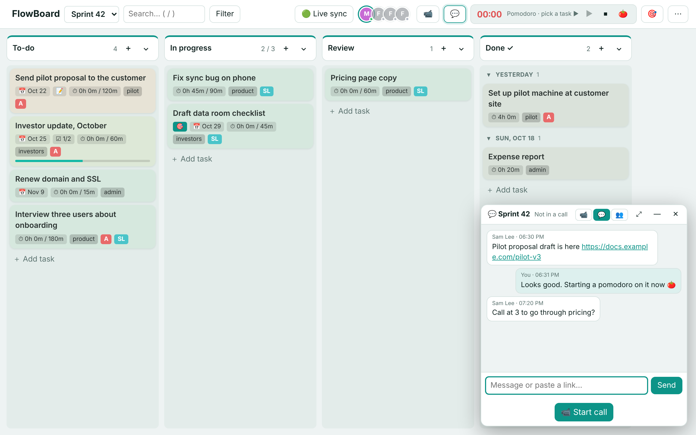
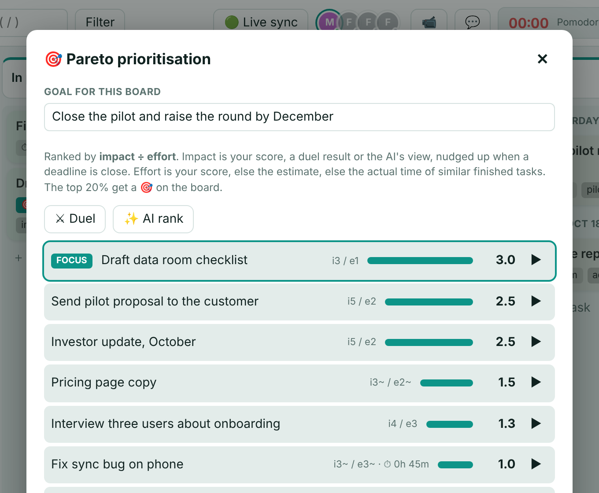

# FlowBoard

A kanban board that fits in one file. Drag tasks between columns, run a pomodoro timer on them, see which tasks are worth your time, work on the same board with a friend, talk to them over video and chat, all inside the board. No account to create, no software to install, nothing to pay.

**[Try it in your browser](https://anasachouri.github.io/flowboard/)** (nothing is uploaded, it runs entirely on your device) or read on to host your own for free.



Made by **Dr Anas Achouri**, materials engineer with a PhD and founder of a UK deep-tech startup. I built FlowBoard to run my own sprints and it grew from there. Say hello on [LinkedIn](https://www.linkedin.com/in/anas-achouri/).

## Who this is for

Anyone who wants a simple, private task board. You do not need to be a programmer. If you can download a file and double click it, you can use FlowBoard. If you can follow a five minute setup once, you can also use it online from your phone and share it with a friend.

## What it does

- Boards with columns and rows (swimlanes). Drag tasks around, or use the small arrow on each task to send it to another column.
- Each task has notes, subtasks, labels, a due date, attachments, a time estimate and a repeat option.
- A pomodoro timer. Press play on a task and the time you spend is logged to it.
- A Pareto view that tells you which tasks give the most value for the least effort. It works out of the box, learns from quick "which matters more" questions, and can ask an AI to rank your tasks against a goal you type.
- Charts: how work flows through your columns, how many tasks you finish per day, where your hours went.
- Works on phones. Swipe between columns, tap and hold a task to drag it.
- Live sync between your laptop and phone when you host it online (see below).
- Invite links so a friend can see and edit one board without seeing your others.
- Video calls and a chat on every shared board. Peer to peer, nothing is recorded.
- Dark mode, search, filters, undo, keyboard shortcuts, backups.

## Three ways to use it

### 1. Just open the file (no setup at all)

1. Download this repository (green **Code** button on GitHub, then **Download ZIP**) and unzip it.
2. Double click `flowboard.html`. It opens in your browser and that is the whole app.
3. Everything you type is saved inside that browser on that computer. Use the menu (⋯) then **Export backup** now and then to keep a copy.

Good for: one person, one computer. Not good for: using it on your phone as well, or sharing with anyone.

### 2. Put it online for free (about five minutes, once)

This gives you a private web address for your board that works on every device and syncs between them. It runs on Cloudflare's free plan, which is enough for one person or a small team. You pay nothing and do not need a credit card.

You need two free things first:

1. **A Cloudflare account.** Sign up at https://dash.cloudflare.com/sign-up with your email. Nothing else to configure.
2. **Node.js.** This is a small program that the deploy script uses. Download it from https://nodejs.org (choose the LTS version), run the installer, accept the defaults.

Then, on Windows:

1. Download and unzip this repository as in option 1.
2. Double click `deploy-online.bat`. A black window opens. The first time, your browser opens and asks you to allow Cloudflare: click **Allow**. Wait for the window to print a line that looks like `https://flowboard.yourname.workers.dev`. That is your board's address. Write it down.
3. Double click `set-key.bat`. Type a strong key (think of it as the password for your board), twice. Your typing is hidden on purpose.
4. Open your address with the key at the end, like this: `https://flowboard.yourname.workers.dev/#key=THE-KEY-YOU-CHOSE`. Bookmark that link on each device. On a phone, use "Add to Home Screen" and it behaves like an app.

On a Mac or Linux, open a terminal in the folder and run these three commands instead of the two scripts:

```
mkdir -p public && cp flowboard.html public/index.html
npx wrangler@latest deploy
npx wrangler@latest secret put BOARD_KEY
```

The last command asks you for the key.

To update FlowBoard later, download the new version and run `deploy-online.bat` again. Your tasks are stored on Cloudflare, not in the file, so they are kept.

### 3. Run a small service for friends

The `saas` folder is a second, separate version with email and password accounts, where each person has their own boards and can share them. It is what you would use for a small team or a club. It needs one more free account (Resend, for sending the verification emails). The steps are in `saas/README.md`.

## Sharing a board with a friend (option 2)

1. Open the board you want to share.
2. Menu ⋯ then **Board members** then **Invite links**. Type their name and click **Create invite link**.
3. Send them the link. It opens that one board only. You can revoke it any time from the same place.

Never send your own key to anyone. The invite link is the safe way.

## Calls and chat

On any board that is online (option 2 or 3), the header has two buttons:

- 📹 opens the call window. Click **Start call** and everyone who has the board open gets a ring and a **Join** button. There are controls for mute, camera, screen share and leave. The 👥 tab lists who is on the board and gives you a **Copy call link** to send to someone who is not looking at the board right now.
- 💬 is a chat for that board. Paste links, leave notes. The last 150 messages are kept.

Sound and video go directly between your browsers. The server only helps the two browsers find each other. Nothing is recorded or stored. If a call stays on "connecting", one of you is on a strict office network. The fix is in the section for the person who set the board up, below.

## The Pareto view

Click 🎯 in the header. Tasks are listed from best value to worst. "Value" is impact divided by effort. You can set both numbers on each task, but you do not have to:

- Effort is taken from the time estimate if you gave one, or from how long similar finished tasks took.
- Impact is raised automatically when a deadline is close.
- **⚔ Duel** shows you two tasks and asks which matters more. Answer six to ten times and the ranking follows your judgement.
- **✨ AI rank** sends your open task titles to an AI model on Cloudflare and scores them against the goal you typed at the top. It only runs when you click it and keeps nothing. Scores you typed yourself are never overwritten.

The best 20% get a small 🎯 on their card on the board.



## Your data

- With option 1, everything stays in your browser.
- With option 2, your tasks live in your own Cloudflare account. Nobody else, including the author of FlowBoard, can see them.
- Attachments never leave the device they were added on.
- Menu ⋯ then **Export backup** saves everything as one file. **Import backup** restores it, also on another computer.

## For the person who set up the board (technical)

- **Strict networks and calls.** Add a TURN relay: in the Cloudflare dashboard open Realtime, then TURN, create a key, then in the folder run `npx wrangler secret put TURN_KEY_ID` and `npx wrangler secret put TURN_KEY_API_TOKEN`. No redeploy needed.
- **AI rank.** Uses Workers AI through the `ai` binding already present in `wrangler.jsonc`. The free allowance is 10,000 neurons a day, and one ranking of 40 tasks costs about 200. To use a different model add an `AI_MODEL` variable in `wrangler.jsonc`. To remove the feature delete the `ai` line.
- **Local network sync without Cloudflare.** `start-flowboard.bat` runs a tiny server on your laptop so your phone can sync over the same Wi-Fi. See the help inside the app.
- **How it is built.** One HTML file, no framework, no build step. Board data in a Cloudflare Durable Object. The architecture is described in `flowboard-how-it-works.md`.

## Licence

MIT. Use it, change it, share it. See `LICENSE`.

## Contributing

Issues and pull requests are welcome. Please keep the single file idea: no build step, no runtime dependencies, nothing that would stop `flowboard.html` from working on its own when double clicked.
